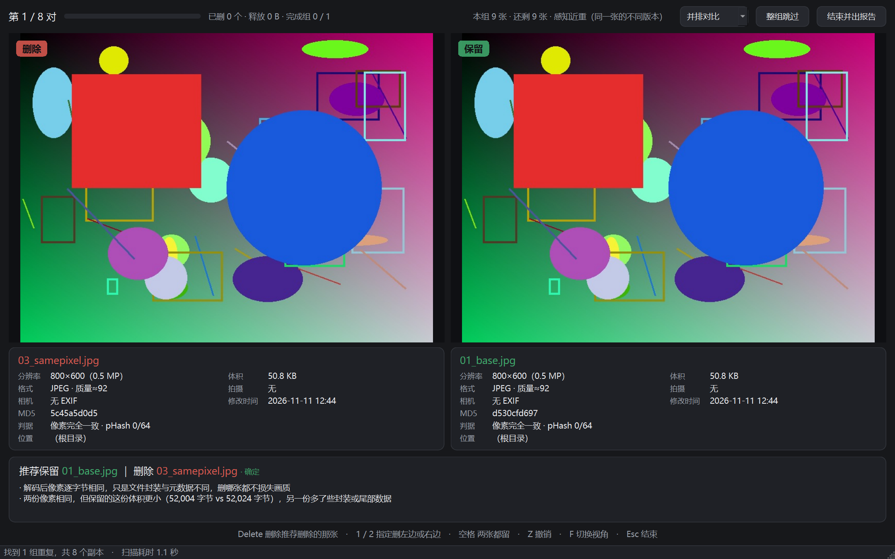
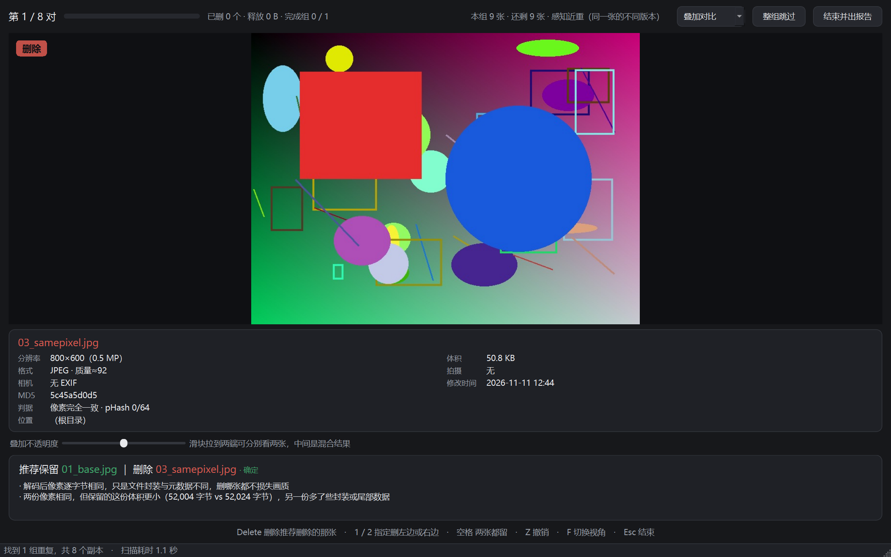
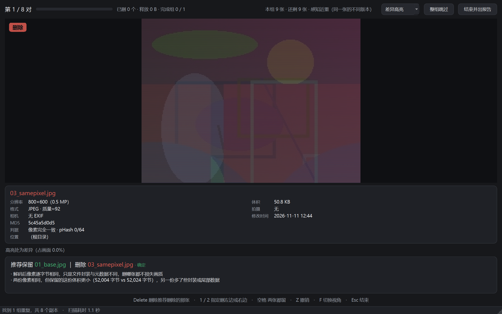
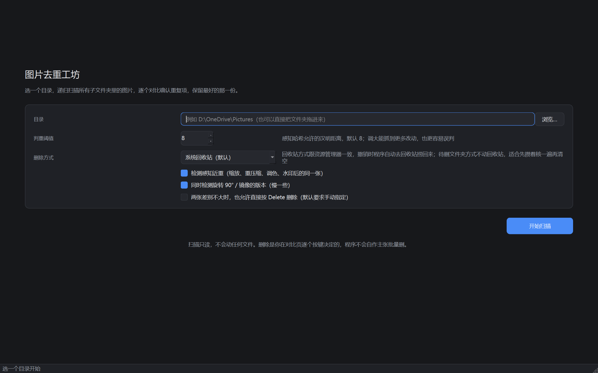
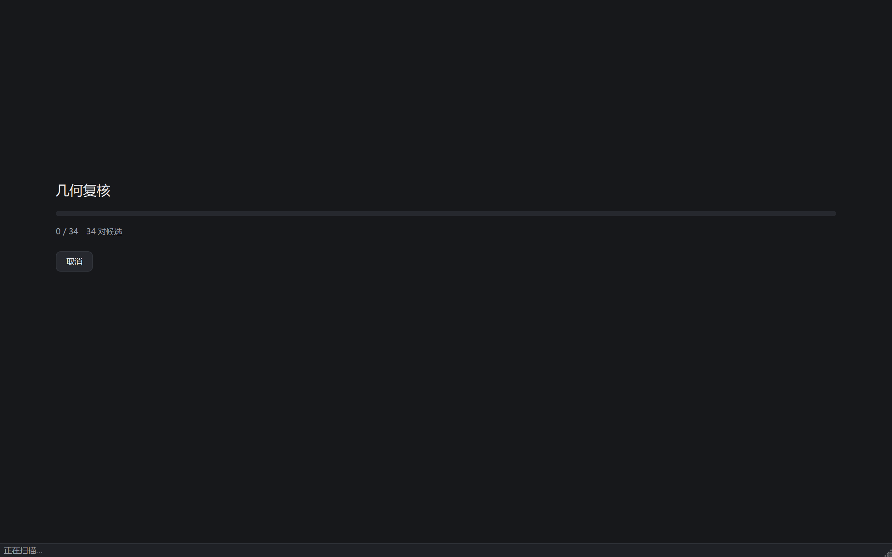
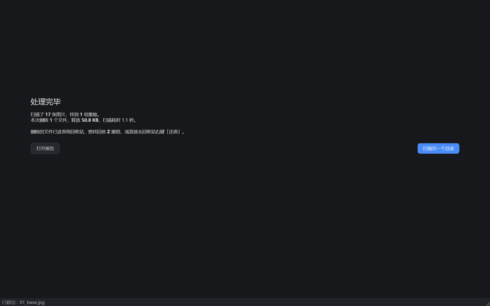

# 图片去重工坊 · PhotoDedup

递归扫描一个目录（含全部子文件夹）里的图片，找出重复项，然后**一张一张陪你确认**：
左右并排看两张图，程序给出「保留哪张、删哪张、为什么」，你按 `Delete` 就删掉不推荐的那张，
自动跳到下一对。全程只读 + 逐个确认，不存在「一键批量删」这种会后悔的操作。

## 界面

对比页——左右并排，各自标着「保留 / 删除」，下方是推荐理由与两张图的信息卡：



除了并排看，还可以切到**叠加**（半透明套在一起，检查是否位移）和**差异**（把不一样的
地方标红，肉眼直接判断「差异是压缩噪点还是内容变了」）：

| 叠加模式 | 差异热图 |
| --- | --- |
|  |  |

扫描 → 对比 → 完成，三个页面的完整流程：

| 起始页 | 扫描进度 | 完成报告 |
| --- | --- | --- |
|  |  |  |

## 它解决什么问题

照片库里同一张图常常有好多份：手机导出的原图、微信转发的压缩版、自己缩放过的版本、
改过 EXIF 的副本、旋转过 90 度的版本……用文件名或者文件大小去找根本找不到，
用 MD5 只能抓到「一个字节都没变」的那些。

这个工具做三件事：

1. **分层判重**——字节层定论、像素层定论、感知层只给候选，越往后越不确定
2. **逐对决策**——擂台式对比，`Delete` 删不推荐的那张，`Z` 随时撤销
3. **留痕**——删了什么、留在哪、为什么，都写进报告

## 快速开始

### 直接用打包好的 exe

```
dist\图片去重工坊.exe
```

双击运行，不需要装 Python。首次启动会解压到临时目录，大约 2–4 秒。

### 从源码运行

```bash
python -m venv .venv
.venv\Scripts\pip install -r requirements-dev.txt
.venv\Scripts\python run.py
```

或 `python -m photodedup`（需要先把 `src` 加进 `PYTHONPATH`）。

## 怎么用

1. 选目录（可以直接把文件夹拖进窗口），按需调判重阈值，点「开始扫描」
2. 扫描完成后自动进入对比页，屏幕左右两张图，各自标着「保留」或「删除」
3. 看下方的推荐理由，觉得对就按 `Delete`；觉得不对按 `1`/`2` 自己指定
4. 一组有多张时是擂台制：删掉一个，赢家继续和下一张比，直到只剩一张
5. 全部走完出报告。默认删到系统回收站，想反悔按 `Z` 撤销，或去回收站右键「还原」

### 快捷键

| 键 | 作用 |
|---|---|
| `Delete` | 删除推荐删除的那张 |
| `1` / `2` | 明确删左边 / 右边 |
| `空格` | 两张都留，问下一对 |
| `Z` / `Ctrl+Z` | 撤销上一次删除 |
| `F` | 切换视角：并排 → 叠加 → 差异高亮 |
| `+` / `-` / `0` | 放大 / 缩小 / 复位 |
| `滚轮` | 以光标为中心缩放，两张图同步 |
| `拖动` | 平移，两张图同步 |
| `Esc` | 结束并出报告 |

### 三种视角

- **并排**：默认，左右各一张，同步缩放平移（拖一张另一张跟着动）
- **叠加**：把 B 半透明叠在 A 上，滑块调到两端可分别看两张，中间是混合，适合找细微位移
- **差异高亮**：把两张的差异放大成红色热力图，适合一眼看出「到底改了哪儿」

## 判重原理

四道关卡，逐层下探：

| 层 | 判据 | 结论强度 |
|---|---|---|
| 1. 字节层 | MD5 相同 | **确定**，删哪张都不损失 |
| 2. 像素层 | 整图解码后 RGB 逐字节相同 | **确定**，只是封装/元数据不同 |
| 3. 感知层 | pHash（DCT 低频 64 位）+ dHash，含 8 种旋转镜像变体 | 只给候选，**永不给确定** |
| 4. 几何层 | ORB 特征 + RANSAC 单应性 + 对齐后差异分布（含**差异块数量**） | 决定候选能不能升级为「较高」 |

第 4 层是必需的，因为**前两层都会同时骗过**：同场景连拍两张，背景完全相同，
pHash 可能只差 8 位、ORB 内点率能到 0.99，但它们是两张不同的照片。唯一区别是——
同一张照片的不同版本，差异是分散的编码噪声（**块数 0**）；连拍的差异集中在物体挪走的那一块；
而两张同版式不同内容的手机截图，差异是**许多处小改动（块数 8）**。

这条判据不是想出来的，是拿 6629 张真实截图跑出来的教训，实测数据见 `docs/algorithm.md`。

## 推荐引擎

按「删错了会心疼什么」排序打分：

| 维度 | 权重 | 判据 |
|---|---|---|
| 像素总数 | 35 | 分辨率越高，放大与二次裁剪空间越大 |
| 有效锐度 | 20 | 拉普拉斯方差，识别过度压缩/缩小 |
| JPEG 质量 | 15 | 从量化表反推（IJG 公式），无损格式另有加分 |
| 同分辨率体积 | 10 | 体积更大通常压缩更轻 |
| 元数据完整度 | 10 | EXIF/机型/GPS/ICC 是否齐全，识别转发副本 |
| 拍摄时间 | 5 | 更早的更像原件 |
| 文件名 | 5 | 是否带 `_副本`/`(1)`/`微信图片` 之类标记 |

两条硬规则：

- **得分差距小于 6 分时，`Delete` 不生效**，要求你按 `1`/`2` 自己指定
- 裁剪、旋转、镜像这类构图差异，额外给警告，不悄悄替你决定

## 安全设计

1. 默认删除方式是**系统回收站**（和资源管理器一致的习惯）。`Z` 键撤销时程序会自己去回收站把文件捞回来；捞不回来就直接报错让你手动还原，不会假装成功
2. 也可以选「移到 `<目录>\_去重待删_<时间戳>\`」：保留原始目录结构，撤销就是移动回去，100% 可还原，适合先攒着核一遍再一键清空
3. **一组至少留一张**：删到只剩一张自动结束该组
4. 删除前校验文件大小与修改时间，被外部改动过就拒删
5. 删除失败不静默，红条提示且停在当前对
6. 不会自动删任何东西——每一个删除都是你按的键

> 回收站还原的两个实现坑（都实测过）：回收站项的 `Item.Path` 指向 `$Recycle.Bin\…` 而不是原位置，
> 所以必须用「删除前所在目录 `System.Recycle.DeletedFrom` + 文件名」配对；谓语规范名是 `undelete`，
> 中文环境显示成「还原」，两个都要试。同名文件删过多次时取最后删的那一份。

## 阈值标定

默认阈值 8 只是起点。判断依据：

- 你库里的照片如果大多是手机原图 + 微信转发，8 够用
- 如果经常出现「明明一样却没抓到」，调到 10–12，代价是混进更多连拍候选（它们会显示为「同场景不同张」而不是直接成组，需要你确认）
- 如果出现「不是同一张却被判成重复」，立刻调小到 5–6，并把那两张图留存下来做为负样本回归测试

## 开发

```bash
.venv\Scripts\python -m pytest -q          # 23 项测试，含连拍/纯色/无关图等负样本
.venv\Scripts\python scripts\diag_scan.py <目录>     # 不开界面，直接看分组与理由
.venv\Scripts\python scripts\ui_preview.py --dir <目录> --out _shots   # 离屏渲染各页面截图
.venv\Scripts\python scripts\make_icon.py            # 重新生成图标
```

### 打包

```bash
.venv\Scripts\python scripts\build.py      # 打包 + 改名 + 自检一条龙
```

产物：`dist\图片去重工坊.exe`（单文件，约 103 MB）。自检会真删一张临时图再把它从回收站捞回来，
确认打包产物里「删除 → 撤销」这条路是通的（`--selftest` 也可以单独跑）。

## 目录结构

```
src/photodedup/
    core/               与界面无关的判重内核，可单测
        scanner.py      递归扫描、格式白名单、跳过规则
        imageio.py      解码、EXIF、JPEG 质量估计、锐度
        hashing.py      MD5 / pHash / dHash / 旋转镜像变体
        verify.py       ORB 几何对齐 + 差异分布 + 判定
        grouping.py     MIH 候选生成 + 并查集
        pipeline.py     流水线编排、线程池、sqlite 指纹缓存
        recommend.py    打分与理由生成
        session.py      擂台队列、删除、撤销、报告
    ui/                 PySide6 界面
        widgets.py      看图控件、信息卡、推荐面板
        compare_page.py 对比页
        pages.py        开始 / 进度 / 结束页
        main_window.py  主窗口、扫描线程、快捷键
tests/                  端到端测试（合成样本）
scripts/                诊断与打包辅助脚本（diag_scan / probe_pair / ui_preview / make_icon / build）
```

## 已知限制

- **大幅裁剪抓不到**：裁掉 20% 会让 pHash 距离跳到 24（阈值才 8），默认不进候选。这是有意的——宁可漏，不可错
- **大面积调色 / 大块水印会被当成「内容不同」**：差异块太大，和「物体挪位」分不开，只能排除
- **纯色/天空/白墙/扫描件**：ORB 提不到特征点，一律给「低」置信，不并组
- **镜像/翻转**：单应性对翻转无效，只能靠指纹变体命中，给「接近」不给「较高」
- **HEIC** 依赖 `pillow-heif`（已随包分发）；RAW（CR3/NEF）只做字节层
- **GIF** 只取首帧
- 感知层的结论永远不是「同一份文件」，删之前请扫一眼画面

## 实测规模

| 目录 | 文件数 | 耗时 | 结果 |
|---|---|---|---|
| 合成样本（9 类变体 + 8 类负样本） | 17 | 1.0 秒 | 1 组 9 张，负样本全部 0 组 |
| `D:\OneDrive\Pictures\截图`（真实手机截图） | 6629 | 63 秒（缓存命中 6625） | 18 组 / 22 个副本，逐对核对成立 |

## 许可

个人使用。判重算法与阈值标定过程的详细说明见 `docs/algorithm.md`。
